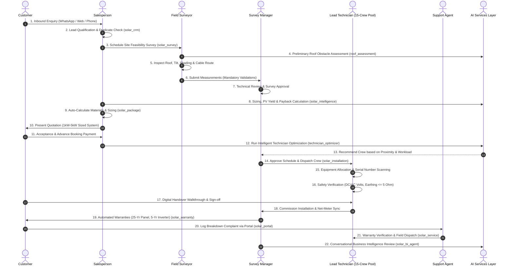
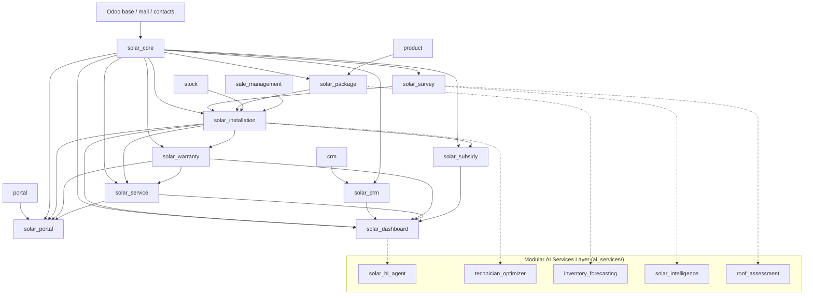
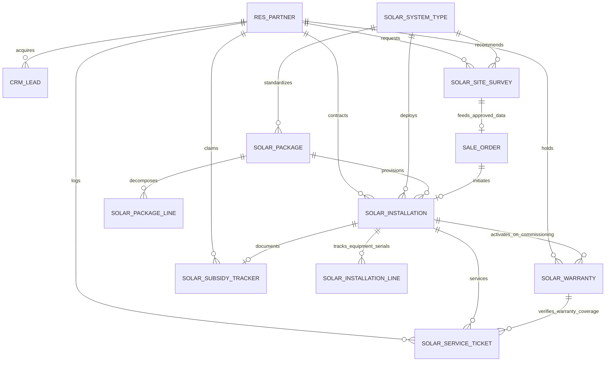

# ARCHITECTURE.md — SolarFlow 360 System Architecture

## 1. Executive Summary
SolarFlow 360 is an enterprise-grade solar installation ERP built natively on **Odoo 17 Community Edition (CE)**. It unifies the fragmented customer journey for **SunPower Solutions**—orchestrating lead acquisition (WhatsApp, calls, web forms), physical site surveys, standardized system packages (1kW to 5kW), multi-technician crew dispatch, quality testing, utility net-metering interconnection, government subsidy dossiers, long-term warranties, customer self-service portal, post-sales field service, and modular AI intelligence services.

---

## 2. Complete Module Dependency Matrix

---

## 3. Modular Architecture Overview (10 Addons + 5 AI Engines)

| Component | Primary Role | Key Models / Engines | Security & Governance Rules |
|---|---|---|---|
| **`solar_core`** | Foundation & Security | `res.partner`, `res.users`, `solar.system.type` | 9 RBAC roles, technician profiles, master sequences. |
| **`solar_crm`** | Lead Qualification | `crm.lead` | Inbound channel tracking, duplicate detection, 48h automated follow-up call activity. |
| **`solar_survey`** | Engineering Feasibility | `solar.site.survey` | Mandatory measurement validations, approval workflow, resurvey revisions, unapproved survey quotation block. |
| **`solar_package`** | System Sizing & BOM | `solar.package`, `solar.package.line` | 1kW-5kW configurations, auto BOM sizing rules (panels, structures, cables), quotation line generation. |
| **`solar_installation`** | Operations & Job Costing | `solar.installation`, `solar.installation.line` | 8-stage lifecycle, 15-technician pool, serial collision prevention, safety testing, job-level gross margin %. |
| **`solar_warranty`** | Guarantee Certificates | `solar.warranty`, `solar.warranty.policy` | Configurable policies (25-yr PV, 5-yr Inverter), serial mapping, 60-day expiry state transition. |
| **`solar_service`** | Breakdowns & Maintenance | `solar.service.ticket`, `solar.service.part.line` | 8-stage repair lifecycle, serial lookup, warranty claim classification (free vs chargeable), spare parts costing. |
| **`solar_subsidy`** | Government Paperwork | `solar.subsidy.tracker` | Central/state rooftop schemes, 6-point checklist, national portal application tracking (segregated from revenue). |
| **`solar_portal`** | Customer Self-Service | Controllers extending `CustomerPortal` | Secure customer tracking for installations, warranties, ticket logging. Isolated by `partner_id`. |
| **`solar_dashboard`**| Executive Control Center | `solar.executive.dashboard`, `solar.global.search.wizard` | Real-time computed KPIs (velocity vs 40 installs/mo, financials), multi-model global search. |
| **`solar_bi_agent`** | AI Business Intelligence | `SolarBIAgent` | Allowlisted tool execution, zero hallucination, RBAC permission gate on financial data. |
| **`technician_optimizer`** | Intelligent Dispatch | `TechnicianOptimizer` | Constraint satisfaction (skills, workload, proximity). Requires manager approval before commit. |
| **`inventory_forecasting`**| Predictive Procurement | `InventoryDemandForecaster` | Blended run-rate forecast based on 40 installs/month target. Suggests procurement with uncertainty bounds. |
| **`solar_intelligence`** | PV Yield & Financials | `SolarGenerationIntelligence` | Physics-grounded solar yield modeling with explicit estimation disclaimers. |
| **`roof_assessment`** | Feasibility Assistant | `RoofAssessmentAssistant` | Geometric obstacle setback deduction. Physical survey verification mandatory. |

---

## 4. Entity Relationship Model (ERD)

