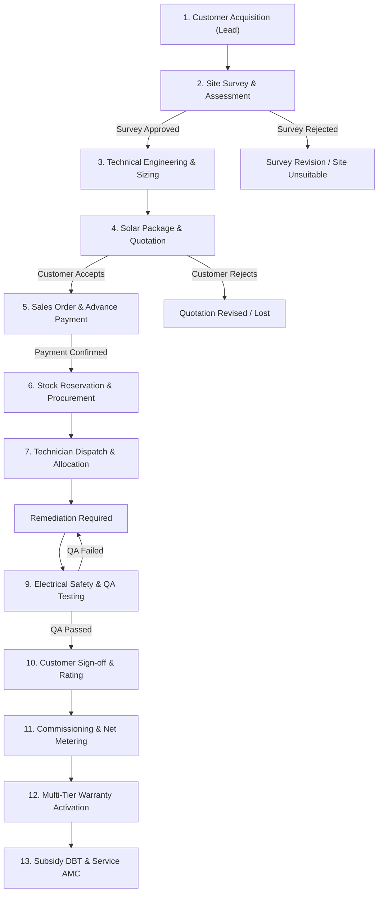

# SolarFlow 360 — Master Workflow State Machine & Lifecycle Transitions

**Organization:** SunPower Solutions  
**Scale Target:** 40 installations / month  
**Architecture:** Odoo 17 CE + SolarFlow 360 Custom Modules  

---

## 1. Master Lifecycle State Diagram

---

## 2. Stage-by-Stage Transition Specifications

### Stage 1: Customer Acquisition (CRM Lead)
- **Model:** `crm.lead` / `res.partner`
- **Initial State:** `new`
- **Allowed Transitions:** `new` -> `contacted` -> `qualified` -> `survey_scheduled` -> `won` / `lost`
- **Actor:** Sales Administrator
- **Guard:** Duplicate phone detection (`is_duplicate` flag). Technicians are barred (HTTP 403) from directly injecting leads.

### Stage 2: Site Survey & Roof Assessment
- **Model:** `solar.site.survey`
- **Initial State:** `draft`
- **Allowed Transitions:** `draft` -> `submitted` -> `approved` or `rejected`
- **Actor:** Operations Manager or Lead Surveyor
- **Guard:** Only Operations Manager, Director, or Lead Surveyor can approve. Sales and Technicians cannot approve surveys. Rejection requires an explicit `rejection_reason`.

### Stage 3: Technical Engineering & Solar Sizing
- **Service:** `SolarGenerationIntelligence` & `RoofAssessmentAssistant`
- **Inputs:** Usable roof sqft, sanctioned load kW, historical monthly electricity bill, panel tilt, azimuth, shading percentage.
- **Validation:** DC/AC ratio strictly validated between 1.10 and 1.30. Annual degradation capped at 0.55%/year.

### Stage 4: Solar Package & Quotation
- **Model:** `solar.package` / `sale.order` (Quotation stage)
- **Initial State:** `draft`
- **Allowed Transitions:** `draft` -> `sent` -> `accepted` or `rejected`
- **Actor:** Sales Administrator
- **Guard:** Cannot generate quotation for an unapproved survey (`state != 'approved'` returns HTTP 400).

### Stage 5: Financial Confirmation (Advance Payment)
- **Model:** `account.payment` / `sale.order`
- **Initial State:** `not_paid`
- **Allowed Transitions:** `not_paid` -> `in_payment` -> `paid`
- **Actor:** Sales Administrator or Operations Manager
- **Guard:** Payment amount must be strictly > 0. Project activation requires payment verification or an authorized credit exception approved by Director via maker-checker flow (`/api/approval-decision`).

### Stage 6: Procurement & Inventory Reservation
- **Model:** `purchase.order` / `stock.picking`
- **Allowed Transitions:** Reorder alert -> Draft PO -> Confirmed -> Stock Received -> Reserved
- **Actor:** Operations Manager
- **Guard:** Field Technicians cannot directly modify stock ledger or issue purchase orders.

### Stage 7: Technician Dispatch & Skill Matching
- **Model:** `project.task` (extended for field crew assignment)
- **Guard 1 (Skill Match):** Installations with capacity >= 5.0 kW require `Three-Phase Certified` certification.
- **Guard 2 (Capacity Limit):** Technicians cannot be assigned beyond their configured `max_jobs` capacity.
- **Guard 3 (Idempotency):** Repeat assignment of the same technician returns HTTP 200 without double-counting active jobs.

### Stage 8 & 9: Installation, Testing & QA
- **Model:** `solar.installation`
- **Allowed States:** `scheduled` -> `in_progress` -> `testing` -> `completed`
- **QA Checklist:** All 5 mandatory checkpoints must pass (`panel_alignment`, `inverter_connections`, `earthing`, `dc_ac_test`, `cable_tray`).
- **Guard:** Failure of any checklist item keeps state in `in_progress` with `testing_passed = False` and triggers an urgent remediation notification.

### Stage 10: Customer Sign-off
- **Model:** `solar.installation` audit fields
- **Actor:** Field Technician & Customer
- **Guard:** Customer name is mandatory; satisfaction rating must be between 1 and 5.

### Stage 11: Commissioning & Net Metering
- **Actor:** Operations Manager or Director
- **Guard:** Requires `testing_passed = True`. Technicians and Salespersons are blocked (HTTP 403) from approving commissioning.

### Stage 12: Warranty Activation
- **Model:** `solar.warranty`
- **Trigger:** Automatic upon successful commissioning sign-off.
- **Tiers Generated:**
  1. 25-Year PV Module Performance Guarantee (80% power retention).
  2. 5-Year Inverter Replacement Guarantee.
  3. 1-Year Comprehensive Installation & Workmanship Guarantee.

### Stage 13: Service & AMC Maintenance
- **Model:** `solar.service.ticket`
- **Initial State:** `new`
- **Allowed Transitions:** `new` -> `in_progress` -> `closed`
- **Guard:** System verifies serial number against active warranties. Under-warranty tickets are classified as `free_warranty` (Rs. 0 customer bill); out-of-warranty tickets are classified as `chargeable`.
